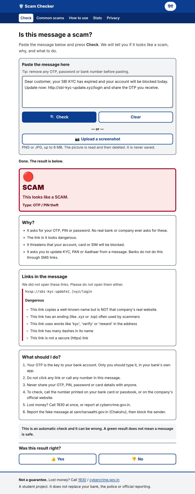
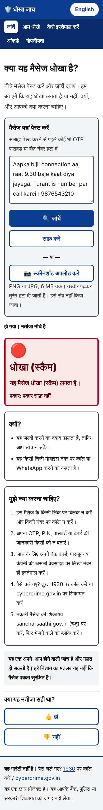

# AI Scam Message Detector

Forward a suspicious SMS or WhatsApp message (or a screenshot) and get, in English or Hindi:

- a verdict: 🔴 **SCAM** · 🟡 **SUSPICIOUS** · 🟢 **LIKELY SAFE** (never a guarantee)
- the likely scam type (fake bank/KYC, OTP theft, lottery, job, "digital arrest", parcel fee...)
- the red flags it found, in plain words
- what to do next, including India's cyber-fraud helpline **1930** and **cybercrime.gov.in**

Built for older and less tech-confident people in India, who receive scams in English, Hindi and Hinglish.

> **Status (17 Nov 2026): working prototype, not yet tested with real users.** The first version was built with AI assistance. All results so far come from public and synthetic data, not from real messages sent to Indian users. See [`docs/TIMELINE.md`](docs/TIMELINE.md) for what is done and what comes next.

## Screenshots

| Checking a fake KYC message (desktop) | Hindi mode on a phone |
|---|---|
|  |  |

Home page: [`docs/screenshots/home.png`](docs/screenshots/home.png)

## Features

- **Text check**: paste any SMS / WhatsApp message and get a 🔴/🟡/🟢 verdict with reasons and advice.
- **Screenshot check**: upload a PNG/JPG/WebP screenshot; Tesseract OCR reads English and Hindi text, then the same check runs.
- **Link analysis without opening links**: look-alike bank/brand names, URL shorteners, risky endings (.xyz, .top), `.apk` downloads, IP-address links, punycode; links are shown "defanged" (`hxxp://...[.]xyz`). Optional Google Safe Browsing lookup.
- **22 red-flag rules** in English, Hinglish and Hindi (OTP requests, KYC/account-block threats, lottery, job fees, "digital arrest", remote-access apps, ...).
- **Machine-learning model**: TF-IDF (words + characters) + logistic regression, combined with the rule score.
- **Bilingual interface** (English / हिंदी) designed for older users: large text, high contrast, keyboard and screen-reader friendly.
- **Telegram bot** with the same engine (text, screenshots, language switch, feedback buttons).
- **Privacy by design**: messages and images are processed in memory and never stored; only anonymous counts feed a public impact dashboard (`/stats.html`).
- **Safety on the API**: rate limiting, strict security headers (CSP), input size limits, admin-token-protected private dashboard.
- **Research pipeline**: reproducible data preparation, baseline training, MiniLM and MuRIL transformer comparisons, fairness-by-language evaluation.

## Tech stack

| Layer | Tools |
|---|---|
| Detection engine | Python 3.10+ (tested on 3.13), scikit-learn, NumPy/SciPy, regular-expression rules |
| Web API + site | FastAPI, Uvicorn, plain HTML/CSS/JavaScript (no framework, no external scripts) |
| OCR | Tesseract (`pytesseract`, Pillow) |
| Bot | Telegram Bot API over `httpx` (long polling) |
| Research | pandas, huggingface_hub (dataset download), sentence-transformers (MiniLM), transformers (MuRIL), PyTorch, matplotlib |
| Tests | pytest (32 tests) |
| Deployment | Dockerfile (includes Tesseract English + Hindi) |

## How it works

```
message ─► clean + detect language ─► link checks (never opens links)
        ─► 22 red-flag rules (EN / Hinglish / HI) ─► rule score
        ─► TF-IDF + logistic regression model     ─► scam probability
        ─► risk = max(both) ─► 🔴 ≥ 0.651 · 🟡 ≥ 0.337 · 🟢 below
        ─► short reply: verdict, type, top reasons, what to do
```

## Results so far (details: [`reports/RESULTS.md`](reports/RESULTS.md))

On a held-out test set of 1,161 public/synthetic messages (294 scams):

| | Deployed system |
|---|---|
| Scams caught (recall) | **96.6%** |
| Warnings that were right (precision) | **90.2%** |
| Safe messages wrongly flagged | **3.6%** |
| Speed / model size | ~2 ms per message on a laptop CPU / 1 MB |

The most important weaknesses:

- **False alarms on Hindi and Hinglish messages are much higher**: 20–25%, against 0.9% for English.
- **Only 4 of 9 disguised scams were caught** in the hand-written challenge set.
- **Accuracy on real messages is unknown.** That is the next step.

Research finding: a model trained only on English spam catches **27%** of Indian-style scams. Adding diverse Indian examples raises that to **95%**.

## Quick start

```bash
python -m venv .venv
```
```bash
source .venv/bin/activate
```
```bash
pip install -r requirements.txt -r requirements-dev.txt
```
```bash
python -m pytest
```
```bash
uvicorn app.server:app --reload
```

Open http://127.0.0.1:8000. For screenshots, install Tesseract (`sudo apt install tesseract-ocr tesseract-ocr-hin`). For the Telegram bot, see the top of [`bot/telegram_bot.py`](bot/telegram_bot.py).

### Run with Docker (includes screenshot OCR)

```bash
docker build -t scam-checker .
docker run -p 8000:8000 scam-checker
```

Then open http://127.0.0.1:8000. The same image can be deployed as a Docker web service (for example on Render; see [`docs/DEPLOYMENT.md`](docs/DEPLOYMENT.md)).

### API

| Method | Path | Body | Returns |
|---|---|---|---|
| `POST` | `/api/check` | `{"text": "...", "lang": "en" \| "hi"}` | verdict, scam type, red flags, links, advice |
| `POST` | `/api/check-image` | multipart: `file`, `lang` | text read from the image + the same result |
| `POST` | `/api/feedback` | `{"verdict": "scam", "kind": "correct"}` | `{"ok": true}` |
| `GET` | `/api/stats` | `?public=1` | anonymous counts |
| `GET` | `/api/health` | – | model / OCR status |

Interactive API docs: http://127.0.0.1:8000/api/docs

Example:

```bash
curl -X POST http://127.0.0.1:8000/api/check -H "Content-Type: application/json" \
  -d '{"text": "Your SBI KYC expired. Update now http://sbi-kyc-update.xyz or account blocked", "lang": "en"}'
```

To re-train and re-evaluate (needs `requirements-ml.txt`):

```bash
python -m training.prepare_data && python -m training.train_baseline && python -m training.evaluate
```

## Repository map

| Folder | Contents |
|---|---|
| `scam_detector/` | The detection engine: rules, link checks, model loading, verdict, messages (EN/HI), anonymous stats, OCR |
| `training/` | Data preparation, baseline training, transformer comparison, evaluation |
| `app/` | FastAPI web server and the accessible website (`app/static/`) |
| `bot/` | Telegram bot |
| `data/challenge/` | 70 hand-written tricky test cases (never used for training) |
| `models/` | Trained baseline model + thresholds |
| `reports/` | Auto-generated results and figures |
| `tests/` | 32 automated tests, including a privacy test |
| `Dockerfile` | Container with the app + Tesseract OCR |
| `docs/` | **Start with [`LEARNING_GUIDE.md`](docs/LEARNING_GUIDE.md)**, then the [timeline](docs/TIMELINE.md), [data card](docs/DATA_CARD.md), [model card](docs/MODEL_CARD.md), [research paper draft](docs/RESEARCH_PAPER.md), [labelling guide](docs/LABELING_GUIDE.md), [pilot protocol + consent forms](docs/PILOT_PROTOCOL.md), [privacy policy](docs/PRIVACY_POLICY.md), [accessibility checklist](docs/ACCESSIBILITY_CHECKLIST.md), [deployment](docs/DEPLOYMENT.md), [outreach plan](docs/OUTREACH_PLAN.md), [competitions](docs/COMPETITIONS.md), [impact tracking](docs/IMPACT_TRACKING.md), [printable guide (PDF)](docs/printable-guide.pdf) |

## Limitations

- Evaluated only on public and synthetic data; accuracy on real messages sent to Indian users is **not yet known**.
- False alarms on Hindi, Hinglish and other code-mixed messages are much higher than on English (see table above).
- The scam-type label is right only about half the time on synthetic data; it often says "type unclear".
- Screenshot OCR is experimental and depends on image quality; voice notes are not supported.
- The Telegram bot has been tested with a simulated Telegram only; Google Safe Browsing has not been tested with a real key.
- The anonymous stats use a local SQLite file, which needs a persistent disk when deployed.

## Privacy

Messages and screenshots are checked in memory and **never stored or logged**. Only anonymous daily counts are kept. See [`docs/PRIVACY_POLICY.md`](docs/PRIVACY_POLICY.md).

## Important

This tool can be wrong. A green result does not mean a message is safe. It does not replace your bank, the police, **1930**, **cybercrime.gov.in**, or reporting fraud messages through **Chakshu** on **sancharsaathi.gov.in**.

## Data credits

UCI SMS Spam Collection (Almeida, Gómez Hidalgo & Yamakami, 2011) · CloveAI/india-spam-sms (MIT) · Ridham115/indian-scam-sms-synthetic-audited (CC BY 4.0). See [`docs/DATA_CARD.md`](docs/DATA_CARD.md).

## License

Code: [MIT](LICENSE). Training data keeps its own licences (see Data credits above).
