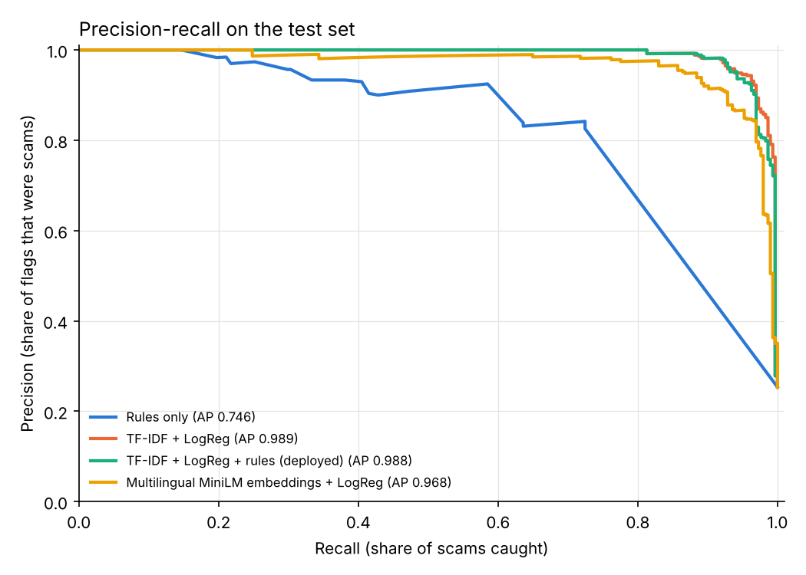

# Results (auto-generated by `python -m training.evaluate`)

> **Read this first.** No real messages from Indian users were available. The test set mixes real English SMS from the UK/Singapore (UCI, ~2011), template-generated Indian SMS (CloveAI) and LLM-written Indian messages (synthetic). These numbers show how the models behave on *this* data. They are **not** an estimate of real-world accuracy for elderly users in India. That needs real, consented, anonymised messages (see docs/TIMELINE.md).

Test rows: 1161 (294 scam/spam). Challenge set: 70 hand-written cases (38 scams). Flag threshold for each system chosen on the validation set so that it flags >= 97% of validation scams.

## 1. All systems, test set

| system                                          |   flag threshold |   precision |   recall |    F1 |   FPR |   FNR |    AP |   ROC-AUC |
|:------------------------------------------------|-----------------:|------------:|---------:|------:|------:|------:|------:|----------:|
| Rules only                                      |            0.2   |       0.841 |    0.721 | 0.777 | 0.046 | 0.279 | 0.746 |     0.846 |
| TF-IDF + LogReg                                 |            0.324 |       0.916 |    0.969 | 0.942 | 0.03  | 0.031 | 0.989 |     0.994 |
| TF-IDF + LogReg + rules (deployed)              |            0.337 |       0.902 |    0.966 | 0.933 | 0.036 | 0.034 | 0.988 |     0.993 |
| Multilingual MiniLM embeddings + LogReg         |            0.328 |       0.826 |    0.969 | 0.892 | 0.069 | 0.031 | 0.968 |     0.986 |
| Multilingual MiniLM embeddings + LogReg + rules |            0.438 |       0.832 |    0.963 | 0.893 | 0.066 | 0.037 | 0.968 |     0.986 |

## 2. All systems, hand-written challenge set (tricky cases, never used in training)

| system                                          |   recall (scams caught) |   FPR (false alarms) |   missed scams |   false alarms |
|:------------------------------------------------|------------------------:|---------------------:|---------------:|---------------:|
| Rules only                                      |                   0.868 |                0.031 |              5 |              1 |
| TF-IDF + LogReg                                 |                   0.763 |                0     |              9 |              0 |
| TF-IDF + LogReg + rules (deployed)              |                   0.868 |                0     |              5 |              0 |
| Multilingual MiniLM embeddings + LogReg         |                   0.868 |                0.094 |              5 |              3 |
| Multilingual MiniLM embeddings + LogReg + rules |                   0.921 |                0.094 |              3 |              3 |

## 3. Deployed system in detail

Thresholds (from validation): SUSPICIOUS >= 0.3373, SCAM >= 0.6512.

Three-way verdicts on the test set:

|             |   scam |   suspicious |   likely_safe |
|:------------|-------:|-------------:|--------------:|
| really safe |      9 |           22 |           836 |
| really scam |    273 |           11 |            10 |

### By data source (test)

| source    |   n |   scams |   recall |   FPR (false alarms) |   precision |
|:----------|----:|--------:|---------:|---------------------:|------------:|
| uci       | 738 |      92 |    0.913 |                0.006 |       0.955 |
| synthetic | 226 |     114 |    0.982 |                0.241 |       0.806 |
| clove     | 197 |      88 |    1     |                0     |       1     |

### By language (test). Check for unfair false alarms on Hindi/Hinglish

| language   |   n |   scams |   recall |   FPR (false alarms) |   precision |
|:-----------|----:|--------:|---------:|---------------------:|------------:|
| en         | 970 |     201 |    0.96  |                0.009 |       0.965 |
| hinglish   |  94 |      44 |    1     |                0.2   |       0.815 |
| hi         |  26 |      14 |    0.929 |                0.25  |       0.812 |
| bn_en      |  23 |      12 |    0.917 |                0.364 |       0.733 |
| mr_en      |  22 |      10 |    1     |                0.083 |       0.909 |
| te_en      |  14 |       9 |    1     |                0.4   |       0.818 |
| ta_en      |  12 |       4 |    1     |                0.5   |       0.5   |

### By scam category (synthetic test scams only, as other sources have no categories)

| category         |   n |   recall |
|:-----------------|----:|---------:|
| delivery_fee     |  25 |     0.92 |
| fake_bank_kyc    |  17 |     1    |
| job_offer        |  17 |     1    |
| otp_theft        |  17 |     1    |
| lottery_prize    |  16 |     1    |
| electricity_bill |  14 |     1    |
| loan_offer       |   8 |     1    |

### Challenge set by language

| language   |   n |   scams |   recall |   FPR (false alarms) |   precision |
|:-----------|----:|--------:|---------:|---------------------:|------------:|
| en         |  49 |      25 |    0.84  |                    0 |           1 |
| hinglish   |  11 |       7 |    1     |                    0 |           1 |
| hi         |  10 |       6 |    0.833 |                    0 |           1 |

Adversarial (disguised) scams caught: **4/9**. Hard negatives (scary-looking genuine messages) correctly left green: **14/14**.

### Every challenge-set mistake (error analysis)

| text                                                                                                                                  | label   | verdict     |   risk | tests                                      |
|:--------------------------------------------------------------------------------------------------------------------------------------|:--------|:------------|-------:|:-------------------------------------------|
| Please share the O.T.P you just received so we can reverse the wrong transaction                                                      | scam    | likely_safe |  0.019 | ADVERSARIAL: O.T.P with dots               |
| Hello dear, kindly do the needful and send the code that came on your phone. It is for your parcel verification.                      | scam    | likely_safe |  0.239 | ADVERSARIAL: 'code' instead of OTP         |
| Sir I am calling from your bank's head office. For security we need to verify your card. Just tell me the 3 digit number on the back. | scam    | likely_safe |  0.3   | ADVERSARIAL: CVV without the word CVV      |
| Hey, is this still your number? I found your profile on a job site, we have a remote role paying 8k a day. Reply to know more.        | scam    | likely_safe |  0.256 | ADVERSARIAL: friendly opener job scam      |
| नमस्ते, मैं बैंक से बोल रहा हूँ। आपके कार्ड के पीछे लिखे 3 अंक बताइए, कार्ड चालू रखने के लिए ज़रूरी है।                               | scam    | likely_safe |  0.226 | ADVERSARIAL: CVV in Hindi without the word |

### Is the scam TYPE we show correct? (only for scams that were caught)

- Synthetic test scams: **56/112** correct type (accuracy 0.5). Note: the synthetic set has only 7 types.
- Challenge-set scams: **26/33** correct type (accuracy 0.788).

Most common type mix-ups (synthetic test):

| true type        | predicted     |   count |
|:-----------------|:--------------|--------:|
| electricity_bill | unknown       |      11 |
| delivery_fee     | unknown       |       9 |
| otp_theft        | unknown       |       9 |
| job_offer        | unknown       |       7 |
| lottery_prize    | unknown       |       5 |
| loan_offer       | unknown       |       5 |
| lottery_prize    | fake_bank_kyc |       2 |
| fake_bank_kyc    | phishing_link |       2 |

Most common type mix-ups (challenge set):

| true type                | predicted     |   count |
|:-------------------------|:--------------|--------:|
| fake_bank_kyc            | phishing_link |       2 |
| fake_bank_kyc            | unknown       |       1 |
| government_impersonation | fake_bank_kyc |       1 |
| lottery_prize            | unknown       |       1 |
| otp_theft                | unknown       |       1 |
| phishing_link            | unknown       |       1 |

## 4. Research experiment: does Indian training data matter?

Same TF-IDF + LogReg model (C=10), trained on growing data, threshold 0.5.

| trained on                       | evaluated on          |    AP |   recall@0.5 |   FPR@0.5 |
|:---------------------------------|:----------------------|------:|-------------:|----------:|
| UCI only (English, UK/SG)        | synthetic Indian test | 0.605 |        0.272 |     0.232 |
| UCI only (English, UK/SG)        | CloveAI test          | 0.704 |        0.83  |     0.349 |
| UCI only (English, UK/SG)        | UCI test              | 0.983 |        0.913 |     0.003 |
| UCI only (English, UK/SG)        | challenge set         | 0.637 |        0.289 |     0.188 |
| UCI + CloveAI (templated Indian) | synthetic Indian test | 0.744 |        0.412 |     0.125 |
| UCI + CloveAI (templated Indian) | CloveAI test          | 1     |        1     |     0     |
| UCI + CloveAI (templated Indian) | UCI test              | 0.982 |        0.913 |     0.003 |
| UCI + CloveAI (templated Indian) | challenge set         | 0.793 |        0.263 |     0.094 |
| UCI + CloveAI + synthetic Indian | synthetic Indian test | 0.984 |        0.947 |     0.134 |
| UCI + CloveAI + synthetic Indian | CloveAI test          | 1     |        1     |     0     |
| UCI + CloveAI + synthetic Indian | UCI test              | 0.98  |        0.902 |     0.002 |
| UCI + CloveAI + synthetic Indian | challenge set         | 0.983 |        0.658 |     0     |

## 5. Speed (CPU, one message at a time, this machine)

| system                          |   ms per message |
|:--------------------------------|-----------------:|
| Rules only                      |             0.18 |
| TF-IDF + LogReg                 |             2.1  |
| Full check_message() (deployed) |             1.86 |

Model details:

- **Rules only**: size_mb=0.03. hand-written red-flag rules + link checks
- **TF-IDF + LogReg**: size_mb=1.0. word + character TF-IDF, logistic regression
- **TF-IDF + LogReg + rules (deployed)**: size_mb=1.0. max(model probability, rule score)
- **Multilingual MiniLM embeddings + LogReg**: size_mb=471, model=sentence-transformers/paraphrase-multilingual-MiniLM-L12-v2 (frozen) + LogisticRegression, C=30, val_average_precision=0.9727, ms_per_message_cpu=7.16, model_size_mb=471. sentence-transformers/paraphrase-multilingual-MiniLM-L12-v2 (frozen) + LogisticRegression
